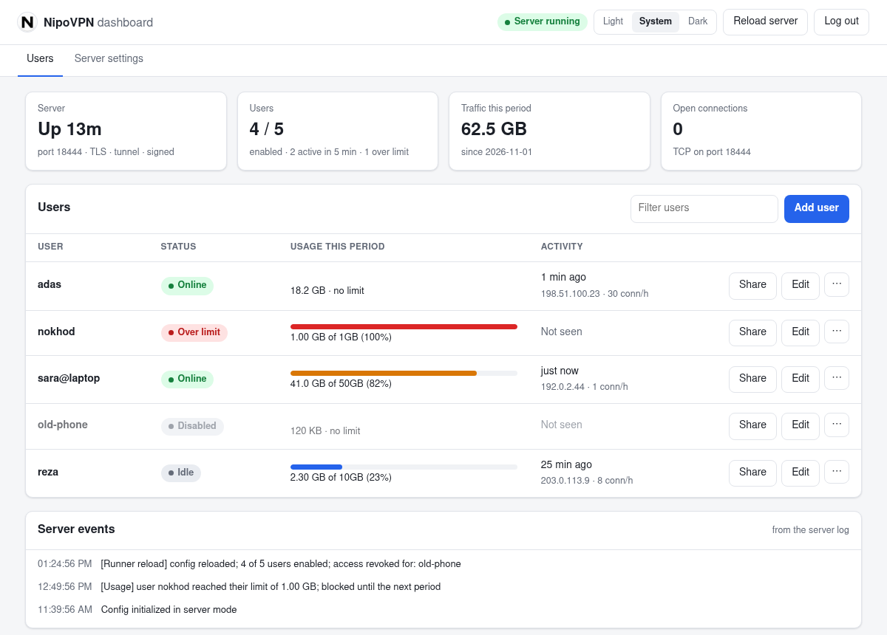

# NipoVPN Dashboard

A web dashboard for managing a [NipoVPN](https://github.com/MortezaBashsiz/nipovpn)
server:

- **Users**: add, edit, enable, disable and delete users, set their monthly limit
  and create new tokens.
- **Server settings**: the agent ↔ server link (tunnel, TLS, AES, timeout), listen
  address and port, threads, TLS certificate, usage reset day, logging, and the
  agent template used for shared configs.
- **Usage**: each user's usage this period against their limit, current
  throughput and who is over their limit. You can reset or set a user's usage.
- **Activity**: whether the server runs and for how long, open connections,
  and when each user was last seen and from which address. The **Server events**
  tab lists events such as reloads, limits reached and errors.
- **Sharing**: for each user, a ready agent `config.yaml` and a `nipovpn://` link
  with a QR code, for the [Android app](https://github.com/MortezaBashsiz/nipovpn-android).



## How it works

The dashboard is a separate program that runs beside a nipovpn server on the
same machine. It does not change how the server works and never talks to it
directly:

| Dashboard                          | Server side                                                            |
|------------------------------------|------------------------------------------------------------------------|
| Changes users                      | rewrites `server.users` in the server's `config.yaml`, then reloads the server |
| Changes server settings            | sets those values in `config.yaml`, then reloads (or restarts) the server |
| Shows usage, sets usage            | reads and edits the usage file (`server.usage.file`)                   |
| Shows activity and events          | follows the server log (`log.logFile`)                                 |
| Shows the process and connections  | reads `/proc`                                                          |

Only the `server.users` block of `config.yaml` is rewritten. Every other line,
comments included, stays as it is, and the previous file is kept as
`config.yaml.bak`. The new users list is checked with the same rules the server
uses before anything is written. After the server reloads, the dashboard shows
its answer, for example `config reloaded; 3 of 4 users enabled`. You can still
edit `config.yaml` by hand; the dashboard reads it fresh for every change.

Usage the server has not written to the usage file yet (it writes every 30
seconds) shows up on the next write. Activity comes from the `[CONNECT]` lines
the server logs at `INFO` level, one for each new connection or tunnel.

It needs Python 3.8 or newer and PyYAML (`apt install python3 python3-yaml`).
It has no other dependencies and loads nothing from the internet.

## Server settings

The **Server settings** tab shows every setting the server reads, grouped like
`config.yaml`. Changed fields are highlighted. **Review and save** lists each change
with what it affects. Saving then sets just those values in `config.yaml`, with
comments and every other line kept and the previous file saved as `config.yaml.bak`.
The server then reloads.

Two kinds of settings need more than a reload:

- **restart to apply**: `listenIp`, `listenPort`, `threads`, `tlsEnable` and the
  usage file only change when the server restarts. The dashboard compares the
  saved values with the ones the server logged at startup and shows what is
  waiting for a restart. The **Restart server** button in the top bar restarts
  it at any time; by default it runs `systemctl restart nipovpn-server`, or the
  `restartCommand` in the dashboard's config (for example for Docker).
- **agents must match**: `tunnelEnable`, `tlsEnable`, `aesEnable` and the listen port
  must be the same on every agent. After changing them, send every user a new
  config or link from the **Share** button.

The **Agent template** section is the `agent:` block of the server's config. The
server does not use it; the dashboard builds shared agent configs and links
from it. Its **Server address** (`agent.serverIp`) is the address put in shared
configs, unless `publicAddress` is set or you type another one in the Share
dialog. **HTTP methods** are checkboxes: pick the ones agents may use.

## Themes

Pick **Light**, **Dark** or **System** (follows the device) in the top bar. The
choice is remembered in the browser.

## Set up

The dashboard has its own Debian package, `nipovpn-dashboard`, beside the
`nipovpn` package. It is architecture independent and needs only `python3` and
`python3-yaml`. Download `nipovpn-dashboard_<version>_all.deb` from the
[releases page](https://github.com/MortezaBashsiz/nipovpn-dashboard/releases)
and install it on the server:

```bash
sudo apt install ./nipovpn-dashboard_1.0.0_all.deb
```

It is separate from the server: its own config and its own systemd service.

| Installed                                      | What                                                       |
|------------------------------------------------|------------------------------------------------------------|
| `/etc/nipovpn-dashboard/config.yaml`           | The dashboard's [config](config.yaml), readable by root only (the directory too) |
| `nipovpn-dashboard.service`                    | Its systemd service; not enabled until you set a password  |
| `/usr/bin/nipovpn-dashboard`                   | The command (`hash-password`, `make-cert`)                 |
| `/usr/lib/nipovpn-dashboard`                   | The program                                                |

Upgrades keep your config and restart a running dashboard. `apt purge` also
removes the config and the certificate made by `make-cert`.

1. Choose a password and put its hash in `/etc/nipovpn-dashboard/config.yaml`:

   ```bash
   nipovpn-dashboard hash-password
   # Dashboard password: ********
   # Again: ********
   # pbkdf2-sha256$200000$9c1e...$41d2...
   ```

   ```yaml
   passwordHash: "pbkdf2-sha256$200000$9c1e...$41d2..."
   ```

2. Check the other settings in the file. The defaults fit a server installed from
   the Debian package.

3. Start it:

   ```bash
   sudo systemctl enable --now nipovpn-dashboard
   ```

4. The dashboard listens on `127.0.0.1:8090` only. Open it through an SSH tunnel
   from your computer:

   ```bash
   ssh -N -L 8090:127.0.0.1:8090 root@your-server
   ```

   and browse to <http://127.0.0.1:8090/>, or turn on [HTTPS](#https) to open it
   directly.

The service:

```bash
sudo systemctl status nipovpn-dashboard
sudo journalctl -u nipovpn-dashboard -f      # its output
sudo systemctl restart nipovpn-dashboard     # after changing its config
sudo systemctl reload nipovpn-dashboard      # load a renewed TLS certificate
```

It runs as root, because it edits the server's config, reads its log and usage
file and signals or restarts the server, but with systemd sandboxing: no new
privileges, private `/tmp` and `/dev`, read-only kernel settings, and so on.

Without the Debian package, run it from a checkout:

```bash
python3 src/nipovpn-dashboard.py hash-password
python3 src/nipovpn-dashboard.py --config config.yaml
```

The dashboard must be able to write the server's `config.yaml` and its usage
file, read the server log and signal the server. Run it as the same user as the
server (root for the Debian package).

## Settings

All settings are in `/etc/nipovpn-dashboard/config.yaml` ([sample](config.yaml)):

| Setting          | Default                    | Meaning                                                                |
|------------------|----------------------------|------------------------------------------------------------------------|
| `listenIp`       | `127.0.0.1`                | Address to listen on                                                   |
| `listenPort`     | `8090`                     | Port to listen on                                                      |
| `tlsEnable`      | `false`                    | Serve HTTPS; see [HTTPS](#https)                                       |
| `tlsCertFile`    |                            | Certificate (PEM, chain allowed), when `tlsEnable` is true             |
| `tlsKeyFile`     |                            | Its private key                                                        |
| `passwordHash`   | (required)                 | From `nipovpn-dashboard hash-password`                                 |
| `nipovpnConfig`  | `/etc/nipovpn/config.yaml` | The server's config file                                               |
| `reloadCommand`  | `[]`                       | Command that reloads the server; empty sends `SIGHUP` to the nipovpn server process |
| `restartCommand` | `[]`                       | Command the **Restart server** button runs; empty runs `systemctl restart nipovpn-server` (no button without systemctl) |
| `logFile`        | `log.logFile` of the server | The server log, if it is somewhere else from the dashboard's view      |
| `usageFile`      | `server.usage.file`        | The usage file, if it is somewhere else from the dashboard's view      |
| `publicAddress`  | `agent.serverIp`           | Address agents use to reach the server, for shared configs and links   |
| `publicPort`     | `server.listenPort`        | Port agents use to reach the server                                    |
| `allowedHosts`   | `[]`                       | Host names, besides IP addresses and `localhost`, the page may be opened under |
| `sessionHours`   | `12`                       | How long a login lasts                                                 |

Changes apply when the dashboard restarts (`systemctl restart nipovpn-dashboard`).

## HTTPS

With TLS on, you can open the dashboard directly instead of through an SSH
tunnel. Create a self-signed certificate for the address you open it with:

```bash
sudo nipovpn-dashboard make-cert --host 203.0.113.10    # the server's IP or host name
# writes /etc/nipovpn-dashboard/dashboard.crt and dashboard.key (key readable by root only)
```

and set in `/etc/nipovpn-dashboard/config.yaml`:

```yaml
listenIp: "0.0.0.0"
tlsEnable: true
tlsCertFile: "/etc/nipovpn-dashboard/dashboard.crt"
tlsKeyFile: "/etc/nipovpn-dashboard/dashboard.key"
allowedHosts: []          # add the host name here if you open it by name
```

then `sudo systemctl restart nipovpn-dashboard` and browse to
`https://203.0.113.10:8090/`. The browser warns about a self-signed certificate.
Before accepting it, compare its SHA-256 fingerprint with the one on the server:

```bash
openssl x509 -in /etc/nipovpn-dashboard/dashboard.crt -noout -fingerprint -sha256
```

A certificate from a CA, such as Let's Encrypt, works too: point `tlsCertFile`
(the full chain) and `tlsKeyFile` at it. A renewed certificate is loaded within a
minute, or at once with `systemctl reload nipovpn-dashboard`, without logging
anyone out. The dashboard only accepts TLS 1.2 and newer. Over HTTPS the login
cookie is `Secure`, and the dashboard sends `Strict-Transport-Security`.

Open only the dashboard's port in the firewall, and only to the addresses you
manage it from if you can.

## Docker

The dashboard runs on the host, not in the container. Mount the server's config
read-write (nipovpn's [compose file](https://github.com/MortezaBashsiz/nipovpn/blob/main/docker/docker-compose.yaml) mounts it read-only),
and tell the dashboard how to reload the container and where the log and usage
file are on the host (`docker volume inspect` shows a volume's path; the
paths below are examples):

```yaml
nipovpnConfig: "/path/to/nipovpn/etc/nipovpn/config.yaml"
reloadCommand: [docker, kill, --signal=HUP, nipovpn]
restartCommand: [docker, restart, nipovpn]
logFile: "/var/lib/docker/volumes/docker_nipovpn_logs/_data/nipovpn.log"
usageFile: "/var/lib/docker/volumes/docker_nipovpn_state/_data/usage.yaml"
```

## Security

- Without TLS the dashboard serves plain HTTP, so keep `listenIp: 127.0.0.1` and
  use an SSH tunnel. Listening on another address without TLS exposes the
  password and every user's token to the network, and the dashboard warns about
  it at startup. With TLS, see [HTTPS](#https).
- Passwords are stored as PBKDF2-SHA256 hashes. After 5 wrong passwords in a
  minute, logins are refused for a minute.
- The login is a session cookie (`HttpOnly`, `SameSite=Strict`). Every API
  request also needs a custom header, so other web pages cannot make requests
  for you. Requests under host names other than IP addresses, `localhost` and
  `allowedHosts` are refused, which stops DNS rebinding.
- Shared configs, links and QR codes contain the user's token. Send them only to
  that user, and create a new token if one leaks.

## Building the package

```bash
packaging/build-deb.sh 1.0.0 build      # needs dpkg-deb; writes build/nipovpn-dashboard_1.0.0_all.deb
docker run --rm -v "$PWD:/src:ro" ubuntu:24.04 \
  sh /src/packaging/smoke-test.sh /src/build/nipovpn-dashboard_1.0.0_all.deb
```

GitHub Actions:

| Workflow | When | What |
|---|---|---|
| [test.yml](.github/workflows/test.yml) | pull requests, pushes | the tests, against a nipovpn server built from source |
| [release-main.yml](.github/workflows/release-main.yml) | pushes to `main` | builds the package, installs it on a clean Ubuntu 24.04 and checks it answers, and releases `v<version>` |
| [release-dev.yml](.github/workflows/release-dev.yml) | pushes to `dev` | the same, released as `dev-v0.1.<run>` |

## Layout

| Path | What |
|---|---|
| [src/](src) | the program: `nipovpn-dashboard.py` and its modules, and the page in `static/` |
| [config.yaml](config.yaml) | the sample config, installed as `/etc/nipovpn-dashboard/config.yaml` |
| [packaging/](packaging) | the systemd unit, the Debian package files, `build-deb.sh` and `smoke-test.sh` |
| [tests/](tests) | the tests; `fixtures/config.yaml` is nipovpn's sample config |

## Tests

[tests/test_dashboard.py](tests/test_dashboard.py) tests the config rewrite, the
user rules, the server settings, the agent configs and links, the QR codes
(decoded with `zbarimg` when installed), HTTPS, the API and its security
checks. Given a nipovpn checkout it also compares shared links with nipovpn's
`scripts/config2url.py`, and given a nipovpn binary it drives a real server
through reloads:

```bash
python3 tests/test_dashboard.py                                   # needs python3-yaml
python3 tests/test_dashboard.py --nipovpn ../nipovpn --binary ../nipovpn/build/core/nipovpn
```

## License

[GPL-3.0](LICENSE), like NipoVPN.
